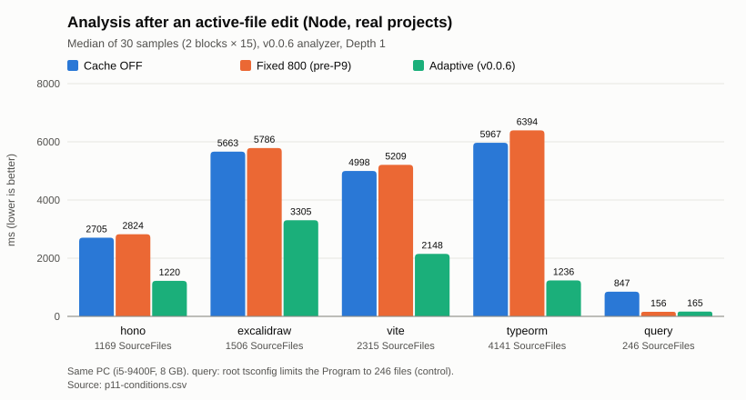

# 분석기 벤치마크 결과 (RQ1)

225블록(5 프로젝트 × 45블록) 모두 완료했다. 실패·SKIP 0건, 메모리 게이트 대기 0건. 블록별 완전성 점검: [data/raw/check-*.json](data/raw/). 원시 표본: [data/raw/](data/raw/) `p11-*.blocks.jsonl.gz`, 요약: [data/summary/p11-conditions.csv](data/summary/p11-conditions.csv), [p11-comparisons.csv](data/summary/p11-comparisons.csv)

## 1. 조건별 중앙값 (ms, 측정 구간 = 결과 캐시 조회 + 분석 + 직렬화)
| 프로젝트 | 시나리오 | OFF | Fixed 800 | Adaptive | Adaptive vs Fixed [95% 구간] | 블록 분리 |
|---|---|---:|---:|---:|---:|---|
| hono | Active-file Edit | 2,704.9 | 2,823.7 | **1,220.1** | −56.8% [−57.5, −56.1] | 예 |
| | Cross-file Edit | 2,666.9 | 2,746.4 | **1,155.4** | −57.9% [−58.2, −57.1] | 예 |
| | File Switch | 2,564.4 | 2,701.4 | **1,191.7** | −55.9% [−58.2, −52.1] | 예 |
| excalidraw | Active-file Edit | 5,662.6 | 5,786.2 | **3,304.7** | −42.9% [−44.4, −41.8] | 예 |
| | Cross-file Edit | 5,774.7 | 5,868.7 | **3,276.7** | −44.2% [−45.1, −41.3] | 예 |
| | File Switch | 3,567.8 | 3,712.9 | **1,601.2** | −56.9% [−58.9, −55.9] | 예 |
| vite | Active-file Edit | 4,998.1 | 5,209.3 | **2,147.5** | −58.8% [−59.1, −58.4] | 예 |
| | Cross-file Edit | 4,953.7 | 5,157.2 | **2,152.4** | −58.3% [−58.7, −57.7] | 예 |
| | File Switch | 4,663.7 | 4,913.7 | **1,950.6** | −60.3% [−61.0, −58.2] | 예 |
| typeorm | Active-file Edit | 5,967.3 | 6,394.0 | **1,236.1** | −80.7% [−80.8, −80.4] | 예 |
| | Cross-file Edit | 5,945.7 | 6,362.4 | **1,244.2** | −80.4% [−80.6, −80.3] | 예 |
| | File Switch | 5,713.4 | 6,091.4 | **1,030.5** | −83.1% [−83.3, −82.8] | 예 |
| query(대조) | Active-file Edit | 847.4 | 155.5 | 164.9 | +6.0% [+1.0, +8.3] | 예(Adaptive가 큼) |
| | Cross-file Edit | 847.5 | 164.7 | 166.7 | +1.2% [−3.6, +7.4] | 아니오 |
| | File Switch | 786.4 | 121.3 | 116.7 | −3.8% [−10.7, +8.5] | 아니오 |

Cold Start와 Warm(cleared)은 캐시가 비어 있는 첫 분석이라 정책 간 차이가 거의 없다. 변화 −3.0%~+6.8%이고 대부분 블록이 겹친다. 반복 Generate는 결과 캐시 경로라 캐시 ON이면 0.5–24 ms이고 두 정책이 같다.

## 2. 해석
1. **고정 800 LRU의 스래싱이 실제 프로젝트에서 재현됐다.**
   - Program이 800 파일을 넘는 4개 프로젝트에서 Fixed 800의 SourceFile hit는 **0%**였다. 분석마다 Program 전체를 다시 파싱하고 그만큼 제거했다(hono 1,169회, typeorm 4,141회/분석).
   - 결과적으로 Fixed 800은 **캐시 OFF보다 2–7% 느렸다**(편집·cross-file·파일 전환 12개 비교 중 11개가 두 블록 모두 OFF보다 느림). 기존 캐시가 이득 없이 비용만 더한 상태였다.
2. **Adaptive는 편집·cross-file·파일 전환을 43–83% 줄였다.** 개선 폭은 Program 중 캐시에 들어간 비율에 따라 다르다.
   - typeorm: 용량 4,185 ≥ Program 4,141 → hit 100%, −81%
   - vite: 용량 2,020 < 2,315 → hit 87%, −59%
   - hono: 용량 800 < 1,169 → hit 68%, −57%
   - excalidraw: 용량 961 < 1,506 → hit 64%, −43%. App.tsx 자체의 큰 분석 비용이 남는다.
3. **Adaptive 용량 산정의 한계(새 발견)**:
   - 용량 = max(800, ⌈1.1 × rootNames⌉ + 200)(상한 4,400)은 Program ≈ rootNames라고 가정했다. 실제로는 `node_modules`의 `.d.ts`와 lib 파일 때문에 Program이 rootNames의 1.14–2.74배였다.
   - 그래서 3개 프로젝트에서 용량이 차고, 남은 파일은 매번 다시 파싱(skipFull)되었다. hono는 분석당 369개, excalidraw 545개, vite 295개.
   - 스캔 저항 fallback 덕분에 스래싱으로 무너지지는 않았지만, 개선 여지가 남아 있다(예: 직전 Program의 SourceFile 수로 용량 산정). 이 변경은 제품 코드라 이번 단계에서 하지 않았다.
4. **대조군(query)**:
   - Program이 246 파일이라 두 정책 모두 hit 100%이고, 캐시 ON이 OFF보다 81–85% 빠르다.
   - 편집에서 Adaptive가 Fixed보다 9.4 ms(+6%) 느렸고 두 블록 모두 같은 방향이었다. cross-file·파일 전환에서는 차이가 없었다.
   - 원인은 확인하지 못했다. 적중마다 Map 순서를 갱신하는 비용일 가능성이 있으나 검증하지 않았다.

## 3. Node 분석 시간과 UI 응답 시간
UI(입력 → 프레임 콜백)에는 350 ms debounce, 메시지 전송, 렌더링, 그리고 **같은 프로젝트를 분석 중인 VS Code TypeScript 서버와의 CPU 경쟁**이 더해진다. 예를 들어 vite 편집에서 Adaptive는 Node 2,148 ms, UI 4,782 ms였고, OFF 반복 Generate는 Node 4,955 ms, UI 11,130 ms였다. 그래서 개선 비율도 UI에서 더 작다(vite 편집 −58.8% → −31.4%). 상세: [ui-results.md](ui-results.md)

## 4. 실패·불가능 조건
- 분석기 벤치마크 실패·SKIP: 없음.
- 첫 전체 실행 `p11-main`은 원시 데이터를 잃어 최종 통계에서 뺐다([methodology.md](methodology.md) 8절).
- 프로젝트별 재실행 중 excalidraw가 한 번 중단됐다. 저장된 34블록은 유지했고, 중단된 블록은 처음부터 다시 측정했다. cross-file 수정은 복원 기록을 남겼다.
