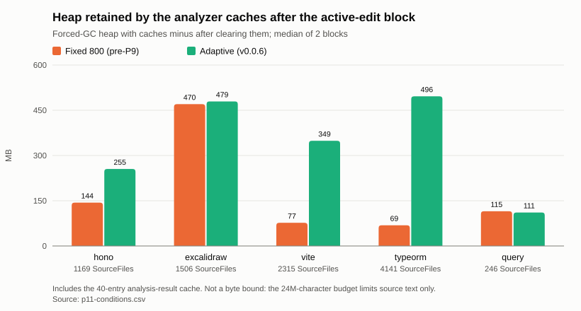

# 메모리와 캐시 상태 (RQ3)

Active-file Edit 시나리오(조건당 2블록 × 15표본). 원자료: [data/summary/p11-conditions.csv](data/summary/p11-conditions.csv)

## 1. 캐시 상태 (블록 전체 합계)
| 프로젝트 | Program | 조건 | 항목/용량 | 캐시 텍스트 | SourceFile hit / miss | evict | skipFull | hit 비율 |
|---|---:|---|---|---:|---|---:|---:|---:|
| hono | 1,169 | Fixed 800 | 800/800 | 4.6 M자 | 0 / 35,070 | 35,070 | 0 | 0% |
| | | Adaptive | 800/800 | 9.8 M자 | 24,000 / 11,070 | 0 | 11,070 | 68.4% |
| excalidraw | 1,506 | Fixed 800 | 800/800 | 6.9 M자 | 0 / 45,180 | 45,180 | 0 | 0% |
| | | Adaptive | 961/961 | 13.2 M자 | 28,830 / 16,350 | 0 | 16,350 | 63.8% |
| vite | 2,315 | Fixed 800 | 800/800 | 3.2 M자 | 0 / 69,450 | 69,450 | 0 | 0% |
| | | Adaptive | 2,020/2,020 | 16.9 M자 | 60,600 / 8,850 | 0 | 8,850 | 87.3% |
| typeorm | 4,141 | Fixed 800 | 800/800 | 3.0 M자 | 0 / 124,230 | 124,230 | 0 | 0% |
| | | Adaptive | 4,141/4,185 | **21.9 M자** | 124,230 / 0 | 0 | 0 | 100% |
| query | 246 | 두 정책 | 246/800 | 4.9 M자 | 7,380 / 0 | 0 | 0 | 100% |

**용량 상한 도달 시점**:
- 항목 용량: hono·excalidraw·vite는 첫 분석에서 용량이 찼다. 이후 매 분석에서 같은 수의 파일이 skipFull(캐시하지 않고 파싱)되었다.
- 문자 예산(2,400만 자): 어느 프로젝트에서도 넘지 않았다. typeorm은 2,190만 자로 **예산의 91%**까지 찼다. typeorm보다 큰 프로젝트에서는 문자 예산이 먼저 제한할 것이다.

## 2. 프로세스 메모리 (중앙값, MB)
| 프로젝트 | 조건 | heapUsed | heapTotal | RSS | RSS 최대 | 유지 힙 (GC 후 캐시 있음 − 비움) |
|---|---|---:|---:|---:|---:|---:|
| hono | OFF / Fixed / Adaptive | 645 / 725 / 632 | 737 / 821 / 720 | 1,283 / 1,308 / 983 | 1,382 / 1,379 / 1,411 | 0.3 / 144 / **255** |
| excalidraw | OFF / Fixed / Adaptive | 643 / 679 / 939 | 938 / 934 / 1,130 | 1,613 / 1,482 / 1,526 | 1,765 / 1,531 / 1,625 | 0.3 / 470 / **479** |
| vite | OFF / Fixed / Adaptive | 866 / 852 / 794 | 974 / 988 / 877 | 1,853 / 1,638 / 973 | 1,908 / 1,879 / 1,320 | 0.3 / 77 / **349** |
| typeorm | OFF / Fixed / Adaptive | 598 / 597 / 763 | 786 / 742 / 862 | 1,501 / 1,409 / 957 | 1,519 / 1,516 / 1,193 | 0.2 / 69 / **496** |
| query | OFF / Fixed / Adaptive | 286 / 230 / 224 | 419 / 322 / 318 | 640 / 373 / 366 | 807 / 406 / 407 | 0.1 / 115 / 111 |

- **유지 힙 증가(Fixed → Adaptive)**: hono +112 MB, excalidraw +9 MB, vite +272 MB, typeorm +428 MB. 유지 힙에는 결과 캐시(최대 40항목)도 들어 있다. excalidraw는 그래프가 커서(677 노드, trace 4,002건) 결과 캐시 비중이 크고, Fixed 800도 470 MB를 유지했다.
- **텍스트 대비 힙**: Adaptive의 유지 힙은 캐시 텍스트 1자당 약 21–36 바이트였다(vite 20.6, typeorm 22.7, hono 26.0, excalidraw 36.3). AST와 바인딩 정보가 텍스트의 10배 이상을 차지한다. 그래서 **2,400만 자 예산은 바이트 상한이 아니며, 예산까지 차면 약 0.5–0.9 GB의 힙을 유지할 수 있다**(외삽 추정, 검증하지 않음).
- **RSS**: 큰 프로젝트(vite, typeorm)에서는 Adaptive의 RSS 중앙값과 최대값이 OFF/Fixed보다 낮았다. 매번 다시 파싱하며 생기는 임시 할당과 GC 부담이 줄었기 때문으로 보인다(측정값이며 원인은 추정). 반대로 heapUsed는 Adaptive가 큰 경우가 있다(excalidraw, typeorm).
- 측정은 Node 프로세스 기준이다. 실제 VS Code 확장 호스트에서는 TypeScript 서버·다른 확장과 메모리를 나눠 쓴다.

## 3. 결론
Adaptive는 실제 프로젝트에서 최대 약 0.5 GB의 힙을 캐시에 유지했다. 8 GB PC에서 VS Code와 TS 서버와 함께 쓰면 무시할 수 없는 크기다. 현재의 문자 수 예산만으로는 메모리를 예측할 수 없으므로, 바이트 기반 예산이나 사용자 설정 상한을 검토할 가치가 있다(제품 변경은 하지 않음).
