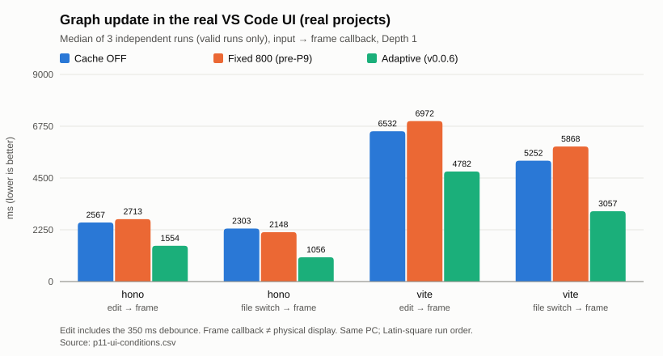

# 실제 VS Code UI 결과 (RQ4)

hono(S), vite(L) × OFF / Fixed 800 / Adaptive × 독립 실행 3회(Latin square). 유효 18회, 제외 2회(재측정으로 대체). 원자료: [data/ui/](data/ui/) — `p11-ui-per-sample.csv`(표본 300개, 제외 실행 포함·표시), `p11-ui-conditions.csv`, `p11-ui-memory-monitoring.csv`

## 1. 응답 시간 (입력 → 프레임 콜백, 실행별 중앙값의 중앙값 [최소–최대] ms)
| 프로젝트 | 시나리오 | OFF | Fixed 800 | Adaptive | Adaptive vs Fixed | 3:3 분리 |
|---|---|---|---|---|---:|---|
| hono | 첫 Generate | 3,027 [2,996–3,296] | 3,420 [3,277–3,513] | 3,401 [3,183–4,054] | −0.6% | 아니오 |
| | 반복 Generate | 1,342 [1,207–3,098] | 142 [141–183] | 132 [132–133] | −6.5% | 아니오 |
| | 편집 후 갱신 | 2,567 [2,551–2,941] | 2,713 [2,614–2,773] | **1,554** [1,424–1,683] | **−42.7%** | 예 |
| | 파일 전환 후 분석 | 2,303 [2,254–2,571] | 2,148 [2,110–2,172] | **1,056** [1,000–1,623] | **−50.8%** | 예 |
| vite | 첫 Generate | 7,021 [6,950–7,312] | 7,927 [7,830–9,228] | 8,256 [7,884–8,275] | +4.1% | 아니오 |
| | 반복 Generate | 11,130 [10,163–13,439] | 271 [243–343] | 268 [249–315] | −1.2% | 아니오 |
| | 편집 후 갱신 | 6,532 [6,163–6,636] | 6,972 [6,663–7,115] | **4,782** [3,730–4,792] | **−31.4%** | 예 |
| | 파일 전환 후 분석 | 5,252 [5,105–5,253] | 5,868 [5,620–5,921] | **3,057** [2,940–3,194] | **−47.9%** | 예 |

- 편집 시간에는 350 ms debounce가 포함된다. 프레임 콜백은 물리적 화면 표시 시각이 아니다.
- **분석 시간 감소가 실제 UI에서도 나타났다**: 편집·파일 전환 모두 Adaptive의 실행 중앙값 3개가 Fixed 800의 3개보다 모두 작았다(사전 규칙상 개선). 다만 비율은 Node 분석기보다 작다(vite 편집: Node −58.8%, UI −31.4%). UI 시간에는 debounce·전송·렌더링과 **같은 프로젝트를 분석하는 VS Code TypeScript 서버와의 CPU 경쟁**이 더해진다.
- **첫 Generate는 캐시 ON이 느린 경향**이 있었다. vite에서 OFF 3회가 모두 Fixed·Adaptive보다 빨랐다(캐시를 채우는 비용, 메모리 증가로 추정, 미검증). hono는 범위가 겹친다. Node Cold Start에서는 이 차이가 보이지 않았다.
- 캐시 OFF의 반복 Generate는 UI에서 Node보다 훨씬 느렸다(vite 11.1 s vs 5.0 s). 위와 같은 경쟁 때문으로 보인다.

## 2. 기능 확인
| 항목 | 결과 |
|---|---|
| 그래프 생성 | 18/18 실행 정상(첫·반복 Generate 모두 완료) |
| 노드 더블클릭 → 소스 이동 | 18/18 |
| 편집이 그래프 **데이터**에 반영(결과 payload에 새 함수) | **90/90** (조건별 hono 15/15, vite 15/15) |
| 편집 노드가 **화면에** 보임(DOM + 뷰포트 + hit-test) | hono 9/15, vite 12/15 — **세 조건 모두 같음** |
| 캐시 조건 간 그래프 동일 | 28단계 중 26단계 동일, 2단계는 조건과 무관한 실행 간 변동([correctness-results.md](correctness-results.md) 4절) |

**가시성(P8에서 확인한 문제의 재현)**:
- 반영되지 않은 데이터는 없었다. 그러나 hono는 4·5번째 편집, vite는 5번째 편집의 새 노드가 모든 실행에서 화면 밖에 있었다.
- 활성 파일 그룹은 뷰포트에 걸쳐 있어 이동(pan)이 일어나지 않았다. 그룹이 커지면서 새 노드가 화면 밖에 배치되었고, React Flow 가상화 때문에 DOM에도 없었다.
- 이것은 **데이터 누락이 아니라 Fit/뷰포트 정책 문제**이며, P9/P10에서 불채택한 Fit 변경과 같은 문제 영역이다. 캐시 정책과는 무관하다.

## 3. 메모리 감시와 제외
- 감시 규칙과 변경 이력: [data/run-policy-changes.md](data/run-policy-changes.md).
- **제외(재측정)**: 시간 측정 단계에서 가용 메모리가 500 MB 미만인 실행 2건을 제외했다.
  - hono OFF r0: 첫·반복 Generate에서 최저 340 MB, 첫 Generate 22.7 s
  - vite Fixed 800 r0: 편집 단계에서 최저 296 MB
  - 같은 순서 위치에서 1회씩 재측정했다.
- **페이징 표시**: 측정 단계의 Pages Input/sec > 500은 파일 읽기와 구분되지 않아 표시만 했다. 유효 실행 18회 중 hono 4회, vite 6회가 해당한다.
  - 이들을 뺀 민감도 분석([data/ui/p11-ui-sensitivity-no-paging-flag.csv](data/ui/p11-ui-sensitivity-no-paging-flag.csv))에서도 편집·파일 전환에서 Adaptive가 가장 빨랐다.
  - 남는 실행이 조건당 1–2회뿐이라 보조 자료로만 본다.
- 분석기 벤치마크 결과와 달리, 초기 hono 2회(Fixed r0, Adaptive r0)는 실행 중 메모리 감시가 없던 때 측정했다.
